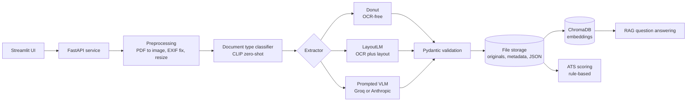
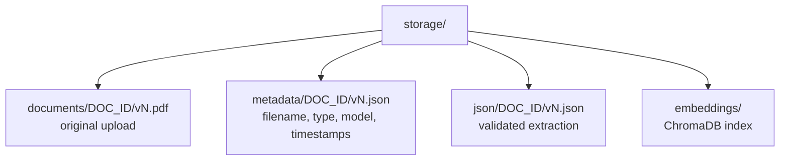
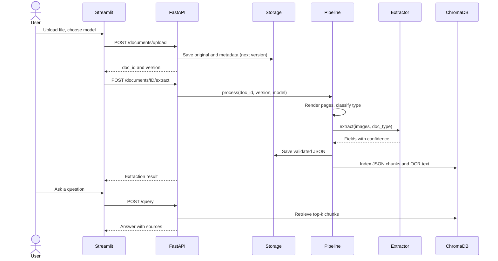
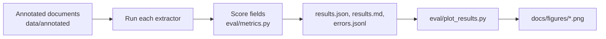
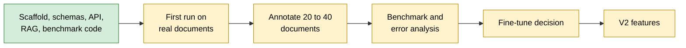

# CareerLens: Multimodal Student Document Intelligence

CareerLens turns student documents into structured, searchable data. Upload a **resume, transcript or certificate** (PDF or image) and the system classifies it, extracts validated JSON with a confidence score per field, keeps every uploaded version, and answers natural-language questions about your documents using retrieval-augmented generation (RAG).

The research contribution is a **benchmark of three extraction approaches on student documents**, with error analysis:

| Approach | Model family | Needs OCR | Fills |
|---|---|---|---|
| OCR-free | Donut (vision encoder-decoder) | No | Scalar fields |
| OCR-dependent | LayoutLM family (text + layout) | Yes (Tesseract) | Scalar fields |
| Prompted VLM | General vision-language model via Groq or Anthropic | No | All fields |

## Contents

1. [Architecture](#architecture)
2. [Request flow](#request-flow)
3. [Supported documents and schemas](#supported-documents-and-schemas)
4. [Project structure](#project-structure)
5. [Setup](#setup)
6. [Configuration](#configuration)
7. [Running the application](#running-the-application)
8. [Benchmark](#benchmark)
9. [API reference](#api-reference)
10. [Design decisions](#design-decisions)
11. [Troubleshooting](#troubleshooting)
12. [Status and roadmap](#status-and-roadmap)

## Architecture



Storage keeps every version of every document and never overwrites:



## Request flow



## Supported documents and schemas

All schemas live in `src/schemas.py`. Every scalar field is `{"value": ..., "confidence": 0.0-1.0}`. Array entries carry one confidence per entry.

| Document | Scalar fields | Array fields |
|---|---|---|
| Resume | name, email, phone, skills | education, experience, projects |
| Transcript | institution, cgpa | semester_marks |
| Certificate | issuer, issue_date, recipient_name, signature_detected, stamp_detected | none |

Which extractor can fill which field:

| Field group | Donut | LayoutLM | Prompted VLM |
|---|---|---|---|
| Name, email, phone, institution, CGPA, issuer, date, recipient | Yes | Yes | Yes |
| Skills, education, experience, projects, semester marks | No | No | Yes |
| Signature and stamp detection | No | No | Yes |

Example output (resume, abbreviated):

```json
{
  "doc_id": "palak_resume",
  "version": 2,
  "document_type": "resume",
  "extraction_model": "prompted_vlm",
  "fields": {
    "name": {"value": "Jane Doe", "confidence": 0.97},
    "skills": {"value": ["Python", "PyTorch"], "confidence": 0.9},
    "education": [{"degree": "B.Tech", "institution": "Example University", "year": "2028", "confidence": 0.92}]
  }
}
```

## Project structure

```
careerlens/
  config.py                    central configuration, reads .env
  requirements.txt
  .env.example                 template for secrets (copy to .env)
  src/
    schemas.py                 all Pydantic schemas (single source of truth)
    pdf_to_image.py            PDF/image loading and light enhancement
    doc_type_classifier.py     CLIP zero-shot document type classifier
    donut_extractor.py         Donut field-by-field extraction
    layoutlm_extractor.py      OCR + LayoutLM-family document QA
    vlm_extractor.py           schema-prompted VLM extraction
    pipeline.py                preprocess, classify, extract, store, index
    storage.py                 file storage for originals, metadata, JSON
    version_manager.py         version numbering and resolution
    vector_store.py            ChromaDB indexing and retrieval
    rag.py                     retrieval-augmented question answering
    ats.py                     rule-based resume ATS scoring
    api.py                     FastAPI routes
    utils.py                   JSON repair, LLM calls, OCR helper
  frontend/app.py              Streamlit UI
  eval/
    metrics.py                 accuracy, exact match, P/R/F1, list F1
    benchmark.py               benchmark runner and error log
    plot_results.py            figures from benchmark results
  data/raw/                    your documents (not committed)
  data/annotated/              ground-truth JSON for the benchmark
  docs/figures/                generated benchmark charts
  tests/                       pytest suite
```

## Setup

### 1. Prerequisites

| Requirement | Why | Install |
|---|---|---|
| Python 3.10 to 3.13 | Runtime. Python 3.14 is not recommended: some ML packages lack builds for it. | python.org |
| Git | Version control | git-scm.com |
| Poppler | Converts PDF pages to images | See below |
| Tesseract OCR | OCR for the LayoutLM baseline and RAG text | See below |
| Groq API key (free) | Prompted VLM and RAG | console.groq.com/keys |
| Hugging Face token (optional) | Avoids download rate limits | huggingface.co/settings/tokens |

Poppler and Tesseract are system programs, not pip packages:

- **Windows:** install both, then add their `bin` folders to your `PATH`. Check with `pdftoppm -h` and `tesseract --version`.
- **macOS:** `brew install poppler tesseract`
- **Linux (Debian/Ubuntu):** `sudo apt install poppler-utils tesseract-ocr`

### 2. Clone and create a virtual environment

Windows (PowerShell):

```powershell
git clone https://github.com/GrandDuchessPalak/careerlens-document-intelligence.git
cd careerlens-document-intelligence
py -3.13 -m venv .venv
.\.venv\Scripts\Activate.ps1
```

macOS / Linux:

```bash
git clone https://github.com/GrandDuchessPalak/careerlens-document-intelligence.git
cd careerlens-document-intelligence
python3 -m venv .venv
source .venv/bin/activate
```

### 3. Install dependencies

```bash
python -m pip install --upgrade pip
pip install -r requirements.txt
```

This downloads PyTorch and other large packages, so expect several minutes.

### 4. Add your keys

Copy the template to a file named exactly `.env` (the code reads only `.env`, never `.env.example`):

```powershell
Copy-Item .env.example .env       # Windows
```
```bash
cp .env.example .env              # macOS / Linux
```

Edit `.env` and fill in your values, with no quotes:

```
GROQ_API_KEY=your_groq_key
HF_TOKEN=your_huggingface_token
LLM_PROVIDER=groq
GROQ_VISION_MODEL=<vision model id from the list command below>
GROQ_MODEL=<text model id from the list command below>
```

Groq retires and renames models often. List what your key can use, then copy the IDs into `.env`:

```bash
python -c "import config; from groq import Groq; [print(m.id) for m in sorted(Groq(api_key=config.GROQ_API_KEY).models.list().data, key=lambda m: m.id)]"
```

Choose a vision-capable model for `GROQ_VISION_MODEL` and a text model for `GROQ_MODEL`. Check Groq's model documentation to see which models accept images.

### 5. Verify the install

```bash
pytest -q
```

All tests should pass. They cover schemas, versioning, API routes, JSON repair, chunking, metrics and the benchmark runner. They do not download any models.

## Configuration

Set these in `.env`. Only the first group is required for the default setup.

| Variable | Default | Purpose |
|---|---|---|
| `GROQ_API_KEY` | none | Groq key for VLM extraction and RAG |
| `LLM_PROVIDER` | `anthropic` | `groq` (free tier) or `anthropic` (paid) |
| `GROQ_VISION_MODEL` | see `config.py` | Groq model used for image extraction |
| `GROQ_MODEL` | see `config.py` | Groq model used for RAG answers |
| `ANTHROPIC_API_KEY` | none | Only if `LLM_PROVIDER=anthropic` |
| `VLM_MODEL` | see `config.py` | Anthropic model ID |
| `HF_TOKEN` | none | Hugging Face downloads |
| `DONUT_MODEL` | `naver-clova-ix/donut-base-finetuned-docvqa` | Donut checkpoint |
| `LAYOUTLM_MODEL` | `impira/layoutlm-document-qa` | LayoutLM-family checkpoint |
| `CLASSIFIER_MODEL` | `openai/clip-vit-base-patch32` | Document type classifier |
| `EMBEDDING_MODEL` | `all-MiniLM-L6-v2` | Embeddings for RAG |
| `CONFIDENCE_THRESHOLD` | `0.5` | The UI flags fields below this value |
| `STORAGE_DIR` | `./storage` | Where documents and JSON are stored |

## Running the application

Run the API and the UI in two separate terminals, each with the virtual environment active and the working directory set to the project root.

Terminal 1, API (interactive docs at http://127.0.0.1:8000/docs):

```bash
uvicorn src.api:app --reload
```

Terminal 2, UI:

```bash
streamlit run frontend/app.py
```

In the UI: upload a document, choose an extraction model, and click **Upload and extract**. The result shows the detected type, low-confidence warnings and the full JSON. Resumes also get an ATS score with reasons. The **Ask questions** tab queries all indexed documents. The first question downloads the embedding model, so it is slower once.

### Command-line quick check

Test the VLM on a single file without starting the servers (replace the file name and document type):

```bash
python -c "from src.pipeline import get_extractor; from src import pdf_to_image as p; print(get_extractor('prompted_vlm').extract(p.prepare('data/raw/my_resume.pdf'), 'resume'))"
```

Or call the API directly:

```bash
curl -F "file=@data/raw/my_cert.pdf" http://127.0.0.1:8000/documents/upload
curl -X POST "http://127.0.0.1:8000/documents/my_cert/extract?model=prompted_vlm"
curl -X POST http://127.0.0.1:8000/query -H "Content-Type: application/json" -d '{"question":"Who issued my certificate?"}'
```

## Benchmark



### 1. Collect and annotate documents

Put 20 to 40 **anonymised** documents in `data/raw/` (they are git-ignored, so they are never committed). For each one, create `data/annotated/<name>.json`:

```json
{
  "image": "data/raw/cert_01.png",
  "document_type": "certificate",
  "tags": ["stamps", "low_res"],
  "fields": {
    "issuer": "Example Institute of Technology",
    "issue_date": "12 March 2026",
    "recipient_name": "Jane Doe"
  }
}
```

`tags` are optional and drive the error analysis. Suggested values: `handwritten`, `low_res`, `rotated`, `stamps`, `signatures`, `tables`, `missing_fields`. Copy `example_certificate.json` and remove its `"_example"` key to get started. Leave a field out (or set it to null) when it is genuinely absent from the document.

### 2. Run the benchmark

```bash
python -m eval.benchmark --models donut layoutlmv3 prompted_vlm
```

Outputs in `eval/results/`:

| File | Contents |
|---|---|
| `results.md` | Comparison table across models |
| `results.json` | All metrics, per-field accuracy, accuracy by tag |
| `errors.jsonl` | Every wrong field with gold and predicted values, for qualitative analysis |

Metrics: extraction accuracy, exact-match rate, precision, recall, F1, per-field accuracy, list F1 for arrays, latency per document, CPU memory and peak GPU memory.

### 3. Generate figures

```bash
pip install matplotlib
python -m eval.plot_results
```

This writes four charts to `docs/figures/`:

| Figure | Shows |
|---|---|
| `overall_metrics.png` | Accuracy, exact match, precision, recall and F1 per model |
| `field_accuracy.png` | Accuracy per field per model |
| `latency_memory.png` | Seconds per document, CPU RAM and GPU memory |
| `accuracy_by_tag.png` | Accuracy under each document condition (low resolution, stamps, and so on) |

Commit the generated images and reference them from this README:

```markdown


```

## API reference

| Method | Route | Purpose |
|---|---|---|
| POST | `/documents/upload` | Upload a file (form field `file`, optional `doc_id`). Re-uploading the same `doc_id` creates a new version. |
| GET | `/documents/{doc_id}/versions` | List all versions with metadata |
| POST | `/documents/{doc_id}/extract?model=&version=&doc_type=` | Classify (if needed), extract, store and index. `model` is `prompted_vlm` (default), `donut` or `layoutlmv3`. |
| GET | `/documents/{doc_id}/json?version=` | Fetch the stored extraction (latest if no version) |
| POST | `/query` | RAG question answering. Body: `question`, optional `doc_ids`, `top_k` |
| POST | `/analysis/ats` | Rule-based resume ATS score with reasons |

Not implemented in v1: `/analysis/jd-match`, `/analysis/career-recommendations`, `/analysis/interview-questions`.

## Design decisions

- **Baselines are queried field by field.** Donut and LayoutLM run as document question answering using the questions in `schemas.FIELD_QUESTIONS`, so they fill scalar fields only. Arrays, skills and signature/stamp flags require the prompted VLM. The split is: benchmark where a baseline exists, prompt where it does not.
- **LayoutLM v1 by default.** No verified public LayoutLMv3 DocVQA checkpoint was available, so `LAYOUTLM_MODEL` defaults to `impira/layoutlm-document-qa` (LayoutLM v1, OCR-dependent). Point it at a LayoutLMv3 checkpoint, or fine-tune LayoutLMv3 token classification on your annotated set, to benchmark v3 itself. Report whichever model you actually ran.
- **Confidence is not comparable across models.** Donut reports mean token probability, LayoutLM the pipeline answer score, and the VLM its own estimate, which is not calibrated. Use confidence to rank fields within a model, not to compare models.
- **Minimal image preprocessing.** Pages are rotated per EXIF, converted to RGB and size-capped. Binarisation and sharpening are deliberately avoided because they hurt OCR-free models.
- **Zero-shot classifier.** CLIP separates the three document types without training. Measure its accuracy on your own documents before relying on it.
- **Free tier by default.** Groq provides both vision extraction and RAG at no cost, with rate limits. Document images are sent to Groq's servers, so use anonymised documents.
- **Schema fix.** The original design spec omitted the `fields` wrapper for transcripts and certificates. All three types now share the same structure.

## Troubleshooting

| Symptom | Cause and fix |
|---|---|
| `No module named 'src'` | Run commands from the project root, not its parent folder. |
| `No module named 'PIL'` (or other packages) | The virtual environment is not active, or `pip install -r requirements.txt` did not finish. Activate the venv and reinstall. |
| `pip install` fails on torch or chromadb | You are likely on Python 3.14. Recreate the venv with Python 3.13 or earlier. |
| `ANTHROPIC_API_KEY is not set` | `.env` is missing or `LLM_PROVIDER=groq` is not set. Confirm with `python -c "import config; print(config.LLM_PROVIDER, bool(config.GROQ_API_KEY))"`; expect `groq True`. |
| Only `.env.example` exists | Copy it to `.env`. The code never reads `.env.example`. |
| `model_not_found` (404) from Groq | The model ID was retired or is not on your account. Run the list command in Setup step 4 and update `.env`. |
| `No module named 'config'` in Streamlit | Ensure `frontend/app.py` adds the project root to `sys.path` before `import config`. |
| `ConnectionError` ... port 8000 refused | The API is not running. Start `uvicorn src.api:app --reload` in a second terminal. |
| `poppler is not installed` | Install poppler and add its `bin` folder to `PATH`, then reopen the terminal. |
| Tesseract not found | Install Tesseract and add it to `PATH`. Without it, OCR text and the LayoutLM baseline are unavailable. |
| Slow Donut or LayoutLM runs | They are heavy on CPU. Run them on a GPU (for example a Colab T4). |
| Push rejected (non-fast-forward) | The remote already has commits. Run `git pull origin main --allow-unrelated-histories --no-rebase`, resolve conflicts keeping your `.gitignore`, then push. |

## Status and roadmap



Verified by automated tests: schemas, storage and versioning, API routes, JSON repair, chunking, metrics, and the benchmark runner (with a stub extractor). Components that depend on downloaded models (Donut, LayoutLM, CLIP, ChromaDB embeddings) need first-run checks on two or three real documents before benchmarking.

Planned for V2: job-description matching, career recommendations and interview question generation. Longer term: more document types, multi-document reasoning, multilingual support, and fine-tuning where baselines prove insufficient.

## Privacy

Never commit real documents or keys. `data/raw/`, `storage/` and `.env` are git-ignored. Uploaded images are sent to the configured model provider (Groq or Anthropic), so anonymise documents used for testing and benchmarking.
