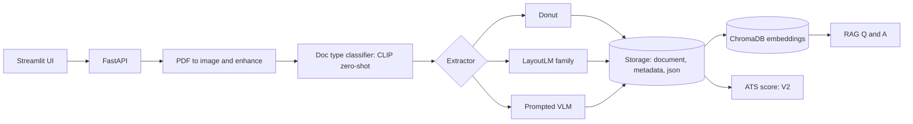

# CareerLens: Multimodal Student Document Intelligence

Upload a **resume, transcript or certificate** (PDF/image) → the system classifies it, extracts
structured JSON with per-field confidence, stores every version, and answers questions about your
documents through RAG. The core contribution is a **benchmark of OCR-free (Donut) vs OCR-dependent
(LayoutLM family) vs prompted-VLM extraction** on student documents, with error analysis.

## Architecture


## Design decisions worth knowing (interview notes)
- **Donut and LayoutLM are queried field-by-field** (document QA with the questions in `schemas.FIELD_QUESTIONS`),
  so they only fill *scalar* fields (name, email, phone / institution, CGPA / issuer, date, recipient).
  Arrays, skills and signature/stamp flags need the **prompted VLM**. This is the "fine-tune/benchmark where a
  baseline exists, prompt where it doesn't" split.
- **LayoutLM, not v3, by default.** I could not verify a public LayoutLMv3 DocVQA checkpoint, so the default
  `LAYOUTLM_MODEL` is `impira/layoutlm-document-qa` (LayoutLM v1, OCR-dependent). Set `LAYOUTLM_MODEL` to a
  LayoutLMv3 checkpoint, or fine-tune LayoutLMv3 token classification on your annotated set, to benchmark v3 itself.
  Report whichever you actually ran.
- **Confidence means different things per model:** Donut = mean token probability, LayoutLM = pipeline answer score,
  VLM = the model's self-reported estimate (not calibrated). Say this when presenting results.
- **Free VLM via Groq.** `LLM_PROVIDER=groq` uses `GROQ_VISION_MODEL` for extraction and `GROQ_MODEL` for RAG. Groq retires models regularly, so confirm the vision model ID at console.groq.com/docs/models. Free-tier rate limits apply; batch benchmark runs may need pauses. Document images are sent to Groq's servers, so use anonymised documents.
- **Classifier** is zero-shot CLIP: simple on purpose. Measure its accuracy on your own documents before trusting it.
- Spec fix: the transcript/certificate schemas in the design doc were missing the `fields` wrapper; they now match the resume schema.
- Deliberate additions to the frozen structure: `src/vlm_extractor.py`, `src/pipeline.py`, `frontend/app.py`.

## Setup
```bash
python -m venv .venv && source .venv/bin/activate     # Windows: .venv\Scripts\activate
pip install -r requirements.txt
cp .env.example .env     # add GROQ_API_KEY (free: console.groq.com/keys); or set LLM_PROVIDER=anthropic + ANTHROPIC_API_KEY
```
OS-level prerequisites (not pip): **poppler** (PDF to image) and **Tesseract** (OCR for LayoutLM and RAG text).
- Linux: `sudo apt install poppler-utils tesseract-ocr`
- macOS: `brew install poppler tesseract`
- Windows: install both binaries and add them to PATH.

## Run
```bash
uvicorn src.api:app --reload          # API at http://127.0.0.1:8000/docs
streamlit run frontend/app.py         # UI
pytest -q                             # tests (schemas, storage/versioning, API, metrics)
```
Quick check with curl:
```bash
curl -F "file=@data/raw/my_cert.pdf" http://127.0.0.1:8000/documents/upload
curl -X POST "http://127.0.0.1:8000/documents/my_cert/extract?model=prompted_vlm"
curl -X POST http://127.0.0.1:8000/query -H "Content-Type: application/json" -d '{"question":"Who issued my certificate?"}'
```

## Benchmark
1. Put 20-40 anonymised documents in `data/raw/`.
2. For each, add `data/annotated/<name>.json` (copy `example_certificate.json`, remove `"_example"`).
   Optional `tags` drive the error analysis: `handwritten, low_res, rotated, stamps, signatures, tables, missing_fields`.
3. `python -m eval.benchmark --models donut layoutlmv3 prompted_vlm`
4. Outputs in `eval/results/`: `results.md` (table), `results.json` (per-field accuracy, accuracy by tag),
   `errors.jsonl` (every wrong field, for your qualitative error analysis).

Metrics: extraction accuracy, exact match, precision/recall/F1, per-field accuracy, latency per document, RSS and GPU memory.

## API (frozen contract)
`POST /documents/upload` · `GET /documents/{id}/versions` · `POST /documents/{id}/extract?model=&version=&doc_type=` ·
`GET /documents/{id}/json?version=` · `POST /query` · `POST /analysis/ats` (V2, rule-based).
Not implemented in v1: `/analysis/jd-match`, `/analysis/career-recommendations`, `/analysis/interview-questions`.

## Status
Verified locally: schemas, storage/versioning, API routes, JSON repair, chunking, metrics, benchmark runner (with a stub extractor).
**Not yet run with real models** (Donut, LayoutLM, CLIP, VLM, ChromaDB): do first-run checks on 2-3 documents before benchmarking.

## Milestones
- [x] Repo scaffold, config, schemas, preprocessing, storage, versioning, API, RAG, benchmark code
- [ ] First end-to-end run on real documents
- [ ] Hand-annotated eval set (20-40 docs)
- [ ] Benchmark + error analysis written up
- [ ] Fine-tune decision (only if baseline is insufficient)
- [ ] V2: JD matching, career recommendations, interview questions

## Future work
More document types, multi-document reasoning, agentic workflows, multi-language, incremental learning, mobile scanning.
